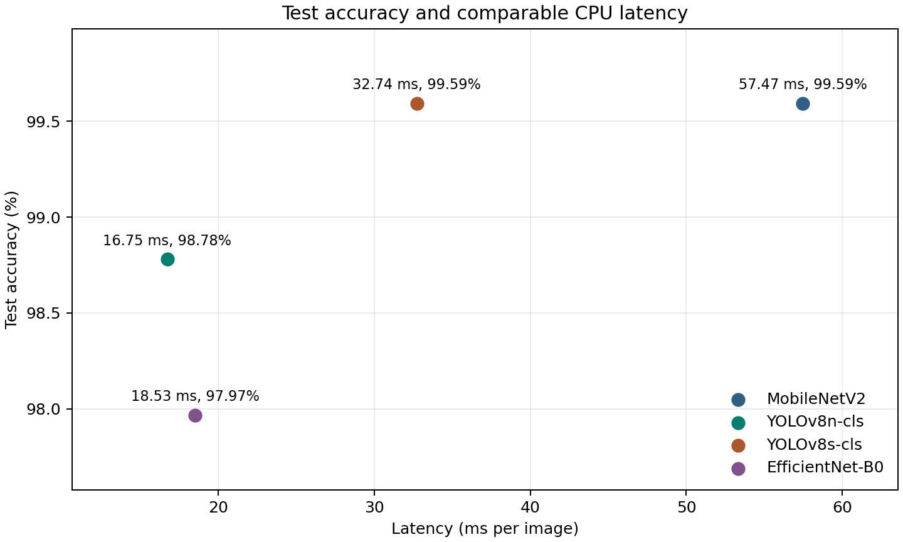
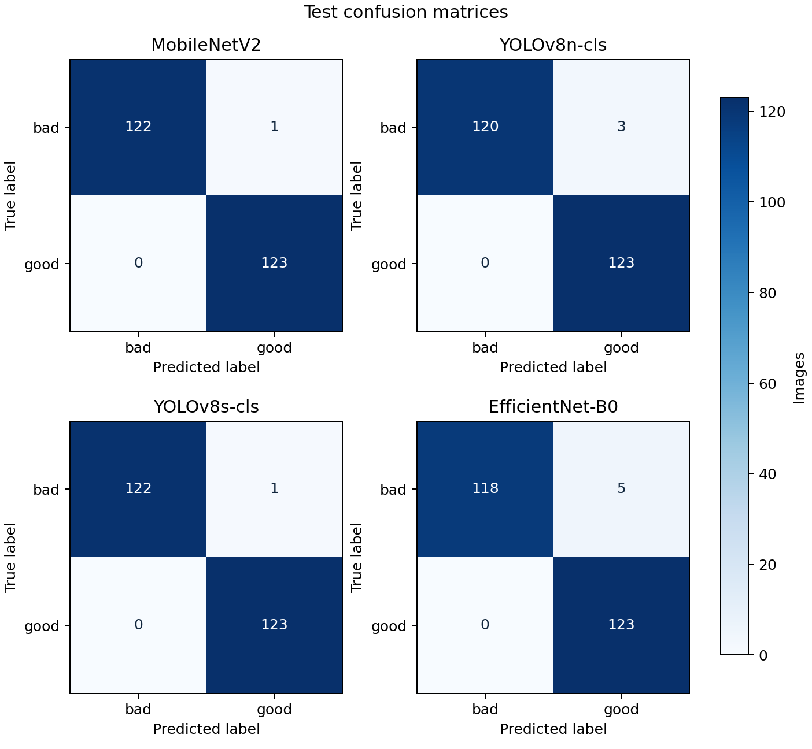

# Task 4 Model Comparison

All models were evaluated on the same 246 test images.
The first table uses the original results.json files for every value.
Model size is in MiB because the original scripts divide file size by 1,048,576.

| Model | Accuracy | Macro precision | Macro recall | Macro F1 | Original latency (ms/image) | Size (MiB) | Parameters | Training time (s) | Epochs run |
|---|---:|---:|---:|---:|---:|---:|---:|---:|---:|
| MobileNetV2 | 0.9959 | 0.9960 | 0.9959 | 0.9959 | 51.92 | 11.06 | 2,422,081 | 192.00 | 28 |
| YOLOv8n-cls | 0.9878 | 0.9881 | 0.9878 | 0.9878 | 14.85 | 2.83 | 1,440,850 | 1,401.84 | 14 |
| YOLOv8s-cls | 0.9959 | 0.9960 | 0.9959 | 0.9959 | 30.31 | 9.78 | 5,083,298 | 4,459.13 | 21 |
| EfficientNet-B0 | 0.9797 | 0.9805 | 0.9797 | 0.9797 | 18.53 | 15.56 | 4,010,110 | 1,238.46 | 50 |

## CPU latency under the same protocol

The original latency values use different timing methods.
The chart uses the same protocol for all four models. On the same CPU, each model used
the same 120 test JPEGs in the same order. The first 20 images were for warm-up.
The next 100 were timed one at a time, from reading the file to getting a predicted class.
Image reading and preparation were included. Model loading was outside the timing.
The first three timings are from the Week 7 repeat check. EfficientNet-B0 used this
protocol in its original run. These measurements were collected in separate runs.

| Model | Comparable latency (ms/image) | Source |
|---|---:|---|
| MobileNetV2 | 57.47 | [week7_comparison.md](week7_comparison.md) |
| YOLOv8n-cls | 16.75 | [week7_comparison.md](week7_comparison.md) |
| YOLOv8s-cls | 32.74 | [week7_comparison.md](week7_comparison.md) |
| EfficientNet-B0 | 18.53 | [results.json](../results/week8_efficientnet_b0/results.json) |

See the [error analysis and failure gallery](error_analysis.md).
The latency sources are also recorded in [task4_cpu_latency.json](task4_cpu_latency.json).
