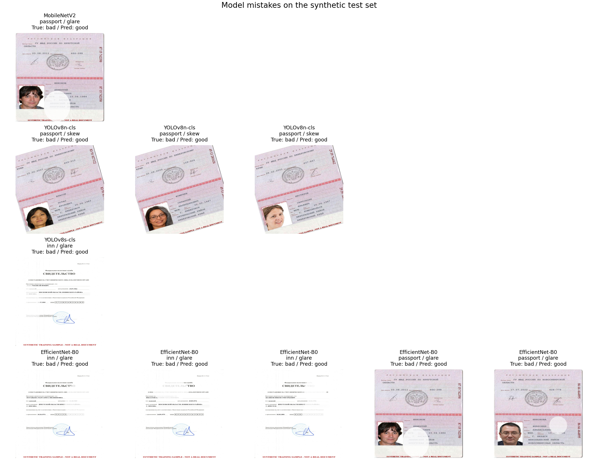

# Task 4 Error Analysis and Failure Gallery

The gallery shows all saved errors from the synthetic test set.
Each example gives the true and predicted labels.
No extra examples were added. Three models made fewer than five errors on this test set,
so their galleries contain all available errors.

| Model | Test errors | Dominant defect among errors | Gallery limit |
|---|---:|---|---|
| MobileNetV2 | 1 | glare (1) | Fewer than five test errors |
| YOLOv8n-cls | 3 | skew (3) | Fewer than five test errors |
| YOLOv8s-cls | 1 | glare (1) | Fewer than five test errors |
| EfficientNet-B0 | 5 | glare (5) | Five examples available |

## Defects on the test set

The same photo can be missed by more than one model. Each model's prediction counts separately.
The pooled miss rate divides the total misses by the number of test images with the defect
times the number of models.

| Defect | Bad test images | Model misses | Pooled miss rate |
|---|---:|---:|---:|
| blur | 25 | 0 | 0.00% |
| exposure | 24 | 0 | 0.00% |
| glare | 26 | 7 | 6.73% |
| occlusion | 23 | 0 | 0.00% |
| skew | 25 | 3 | 3.00% |

**Glare was the hardest defect on this test set by pooled miss rate.**
To reduce glare errors, add training photos with bright reflections in different places.
Vary the size, brightness, and shape of the reflections.
Include real photos taken under lamps and in sunlight, especially for passports and INN documents.
Check the labels with human reviewers and use a separate set of real photos to measure improvement.

## Failure gallery

| Model | Test image | Document | True label | Predicted label | Defect |
|---|---|---|---|---|---|
| MobileNetV2 | [bad_passport_glare_202_v1.jpg](failure_gallery/mobilenetv2_frozen/true_bad__pred_good__bad_passport_glare_202_v1.jpg) | passport | bad | good | glare |
| YOLOv8n-cls | [bad_passport_skew_078_v3.jpg](failure_gallery/week7_yolov8n_cls/true_bad__pred_good__bad_passport_skew_078_v3.jpg) | passport | bad | good | skew |
| YOLOv8n-cls | [bad_passport_skew_268_v1.jpg](failure_gallery/week7_yolov8n_cls/true_bad__pred_good__bad_passport_skew_268_v1.jpg) | passport | bad | good | skew |
| YOLOv8n-cls | [bad_passport_skew_273_v3.jpg](failure_gallery/week7_yolov8n_cls/true_bad__pred_good__bad_passport_skew_273_v3.jpg) | passport | bad | good | skew |
| YOLOv8s-cls | [bad_inn_glare_162_v3.jpg](failure_gallery/week7_yolov8s_cls/true_bad__pred_good__bad_inn_glare_162_v3.jpg) | inn | bad | good | glare |
| EfficientNet-B0 | [bad_inn_glare_092_v2.jpg](failure_gallery/week8_efficientnet_b0/true_bad__pred_good__bad_inn_glare_092_v2.jpg) | inn | bad | good | glare |
| EfficientNet-B0 | [bad_inn_glare_167_v2.jpg](failure_gallery/week8_efficientnet_b0/true_bad__pred_good__bad_inn_glare_167_v2.jpg) | inn | bad | good | glare |
| EfficientNet-B0 | [bad_inn_glare_242_v2.jpg](failure_gallery/week8_efficientnet_b0/true_bad__pred_good__bad_inn_glare_242_v2.jpg) | inn | bad | good | glare |
| EfficientNet-B0 | [bad_passport_glare_202_v1.jpg](failure_gallery/week8_efficientnet_b0/true_bad__pred_good__bad_passport_glare_202_v1.jpg) | passport | bad | good | glare |
| EfficientNet-B0 | [bad_passport_glare_242_v2.jpg](failure_gallery/week8_efficientnet_b0/true_bad__pred_good__bad_passport_glare_242_v2.jpg) | passport | bad | good | glare |
